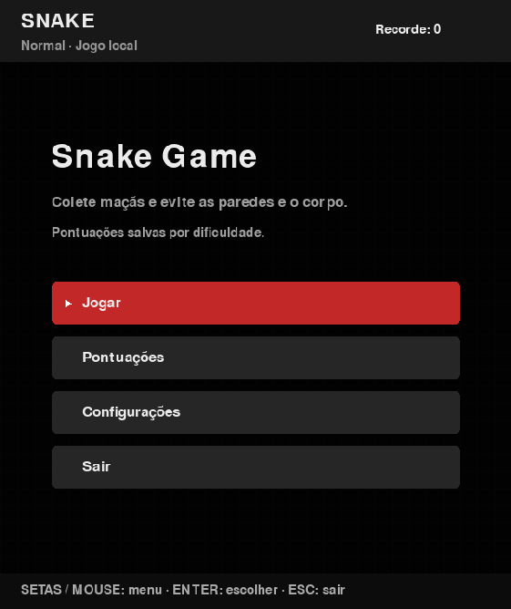
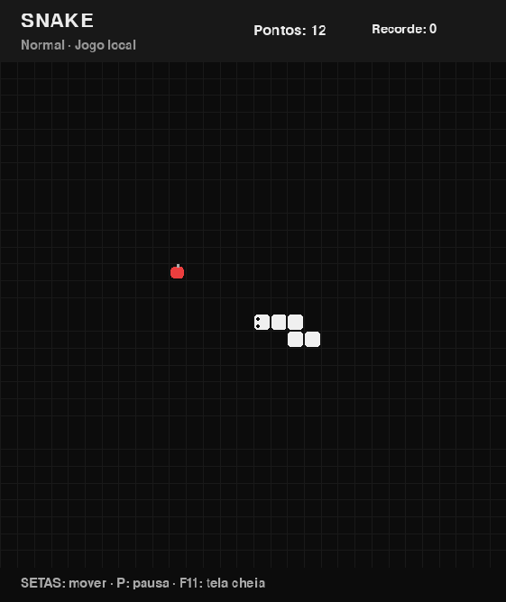
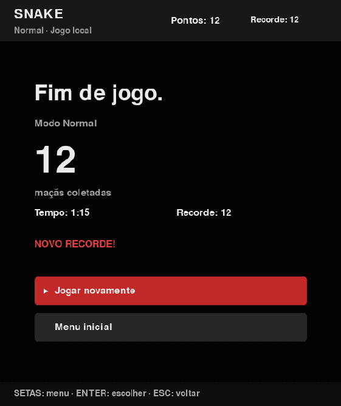

# Snake Game

O clássico jogo da cobrinha, desenvolvido em **Python e Pygame**. Colete maçãs, desvie das paredes e do próprio corpo e supere seu recorde em três dificuldades.

O projeto preserva o visual preto, branco e vermelho, com menus, pontuações locais e um instalador para jogar no Windows sem instalar Python.

## Veja o jogo

<table>
  <tr><th>Menu inicial</th><th>Partida</th><th>Resultado</th></tr>
  <tr>
    <td></td>
    <td></td>
    <td></td>
  </tr>
</table>

Capturas do jogo com dados de demonstração.

## Jogar no Windows

1. Baixe [SnakeGame-Setup.exe](releases/SnakeGame-Setup.exe), na pasta `releases/`.
2. Execute o instalador. O atalho na área de trabalho é opcional.
3. Abra **Snake Game** pelo menu Iniciar e selecione **Jogar**.

Distribuição destinada ao **Windows 10/11 de 64 bits**. O instalador inclui o jogo, suas dependências e um desinstalador. O jogador não precisa de Python nem de conexão com a internet.

## Funcionalidades

- **Tabuleiro de 30 × 30 células:** cobra e maçã maiores, com olhos indicando a direção da cabeça.
- **Três dificuldades:** Fácil, Normal e Difícil, com velocidade crescente e limite máximo.
- **Contagem de preparação:** três segundos antes de iniciar ou retomar, sem avançar o movimento ou o tempo da partida.
- **Pausa:** manual ou automática ao perder o foco, minimizar ou redimensionar a janela.
- **Pontuações por dificuldade:** recorde, Top 5 e últimas 20 partidas de cada modo salvos localmente.
- **Histórico paginado:** data, duração, pontuação, média recente e indicação de partidas interrompidas.
- **Resultado:** maçãs coletadas, duração, recorde e destaque quando um novo recorde é alcançado.
- **Configurações persistentes:** dificuldade preferida e tela cheia.
- **Redimensionamento:** proporção preservada, com faixas quando necessário e cliques ajustados ao tamanho da janela.
- **Regras de colisão:** maçãs apenas em células livres, inversão de direção bloqueada e vitória ao preencher o tabuleiro.

## Dificuldades

A velocidade aumenta **um movimento por segundo a cada cinco maçãs**, até o limite do modo escolhido.

| Modo | Velocidade inicial | Limite |
| --- | ---: | ---: |
| Fácil | 6 movimentos/s | 12 movimentos/s |
| Normal | 9 movimentos/s | 16 movimentos/s |
| Difícil | 12 movimentos/s | 20 movimentos/s |

Os recordes são separados por modo. Na tela Pontuações, alterne a dificuldade para consultar seu Top 5 ou histórico, sem mudar a configuração da próxima partida.

## Controles

| Ação | Controle |
| --- | --- |
| Mover a cobra | Setas do teclado |
| Navegar nos menus | Setas para cima/baixo ou mouse |
| Confirmar opção | Enter, Espaço ou clique esquerdo |
| Pausar / retomar | P ou Esc durante a partida, contagem ou pausa |
| Alternar tela cheia | F11; pausa a partida em andamento |
| Reiniciar no resultado | R ou opção Jogar novamente |
| Mudar página do histórico | Setas esquerda/direita ou botões da tela |
| Voltar ao menu | Esc nas telas de pontuações, configurações e resultado |
| Sair | Opção Sair, Esc no menu inicial ou fechar a janela |

## Executar pelo código

Ambiente validado: **Python 3.12 de 64 bits** e **Pygame 2.6.1**. No PowerShell, dentro da pasta do projeto:

```powershell
py -3.12 -m venv .venv
.\.venv\Scripts\python.exe -m pip install -r requirements.txt
.\.venv\Scripts\python.exe main.py
```

Se `.venv` já estiver preparado, use apenas o último comando. O Python 3.12 precisa estar instalado para criar esse ambiente.

## Dados locais

Preferências e pontuações ficam em:

```text
%LOCALAPPDATA%\AdrianoGames\SnakeGame\profile.json
```

O arquivo fica separado da instalação e é preservado pela desinstalação. O Top 5 permanece disponível mesmo quando uma partida sai do histórico das últimas 20. Partidas encerradas pelo menu ou ao fechar a janela são marcadas como interrompidas; a contagem inicial, antes do primeiro movimento, não gera uma partida no histórico.

O ranking pertence ao perfil local do Windows. Não há ranking online ou cadastro de usuários.

Falhas de gravação são informadas na tela. Se houver dados pendentes, o jogo tenta salvá-los novamente ao sair.

## Estrutura

```text
snake-game/
├── main.py                  # Regras, telas, eventos e desenho
├── storage.py               # Validação e gravação dos dados locais
├── tests/                   # Testes automatizados
├── docs/images/             # Capturas do jogo
├── installer/game.iss       # Configuração do Inno Setup
├── build.py                 # Geração do EXE e instalador
├── requirements.txt         # Dependência do jogo
├── requirements-build.txt   # Ferramentas de empacotamento
├── releases/                # Instalador pronto
└── BUILD.md                 # Compilação e diagnóstico
```

`.venv/`, caches, `build/` e `dist/` são ignorados pelo Git. O instalador em `releases/` acompanha o projeto.

## Testes e distribuição

```powershell
.\.venv\Scripts\python.exe -m unittest discover -s tests -v
```

Os testes cobrem crescimento, colisões, geração de maçãs, direção, velocidades, pausa, contagem, menus, redimensionamento, registros por dificuldade e tratamento de falhas de gravação.

Consulte [BUILD.md](BUILD.md) para gerar o EXE com **PyInstaller**, compilar o instalador com **Inno Setup** ou executar o diagnóstico do pacote. O EXE portátil fica em `dist/SnakeGame.exe`, e o instalador em `releases/SnakeGame-Setup.exe`.
